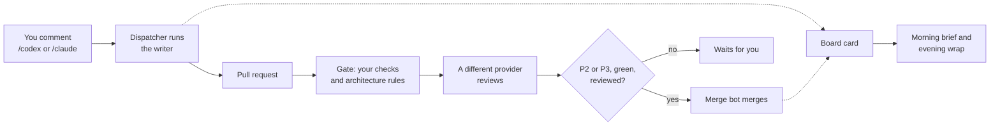

# SoloForge

**English** | [简体中文](README.zh-CN.md)

A GitHub workflow for one maintainer who runs a team of AI coding agents and does not write the code.

One provider's model writes. A different provider's model reviews. Priority labels decide what reaches you. A merge bot merges only what is green and reviewed. Every task leaves a handoff, so the morning brief and the evening wrap come from the task board, not from chat history.

SoloForge is the generic part of a private setup used to run several small game projects this way. It is plain GitHub Actions, Bash, Python, and Node.js. You bring your own AI login or API key.



The result comment from the first live run, a five-line change to a small Python project:

```text
SoloForge result: done.

Rounds: 8. Tokens: 87288. Duration: 30.1 seconds.
```

## Who it is for

It fits one person, or a very small team, who owns the product decisions and lets AI agents write and review the code. The project needs a single check command that can run in CI, and you need access to two AI providers.

It does not fit a team whose main gate is human code review, or a project where an AI command-line tool must not run unsandboxed on a CI runner. v0.1 does not sandbox the agent.

**Why two providers.** The reviewer should not share the writer's blind spots. When no human reads the code, a second provider is the cheapest independent check available.

## How it works

1. **You assign a task.** Write it in an issue, then comment `/codex <instruction>` or `/claude <instruction>`. Only the repository owner's comments start work by default.
2. **The dispatcher runs the writer.** A GitHub Action runs that provider's CLI with your key, commits the result to a task branch, and opens a pull request. It never merges.
3. **The gate checks every pull request.** It runs your project's check command and the architecture rules you keep in `docs/arch-rules.json`.
4. **A different provider reviews.** The review is recorded as an owner comment that names the exact commit it covers. A new commit needs a new record.
5. **The merge bot merges or waits.** It merges when the gate passed for that commit, the pull request carries `P2` or `P3`, no blocking label is present, and the review record matches the head commit. `P0` and `P1` stop and come to you. Fork pull requests are always left for you.
6. **The board keeps the handoff.** Each task has one card with its state, next step, and any blocker or decision waiting for you. Two prompts turn the board into a morning brief and an evening wrap with at most five decisions.

## What is included

| Part | What it does | Start here |
| --- | --- | --- |
| Gate | Reusable workflow that runs your checks and architecture rules on each pull request. Supports Node.js, Python, and Godot. | [gate workflow](.github/workflows/gate.yml), [CI template](templates/ci.yml) |
| Merge bot | Merges eligible pull requests and labels the ones that need you, a rebase, or an architecture review. | [merge workflow](.github/workflows/merge-bot.yml), [review record format](rules/REFERENCE.md#review-record-and-architecture-review) |
| Dispatcher | Turns a `/codex` or `/claude` comment into a task branch and a pull request, with time, turn, token, and hourly start limits. | [dispatcher guide](docs/dispatcher.md), [dispatch template](templates/dispatch.yml) |
| Adapters | One executable per AI provider behind a small contract. Codex, Claude, and a test adapter are included. | [adapter contract](adapters/README.md) |
| Board | One JSON card per task on an orphan `board` branch, with five states and a command-line tool. | [board rules](rules/BOARD.md) |
| Reports and prompts | Morning brief, evening wrap, health check, model check, architecture audit, and monthly retro. | [prompts](prompts/morning-brief.md), [evening wrap](prompts/evening-wrap.md) |
| Rules | Roles, task cards, review steps, `P0`–`P3`, and when an agent decides alone or asks you. | [AI project rules](rules/AI-PROJECT-RULES.md), [reference](rules/REFERENCE.md), [model policy](rules/MODELS.md) |
| Quota patrol | Reads a usage ledger and proposes alerts for low quota and failed or stuck scheduled tasks. | [quota patrol](docs/quota-patrol.md) |
| Starter | A WeChat mini-game project with the gate and the dispatcher already connected. | [starter guide](templates/wechat-minigame/README.md), [parity checklist](templates/PARITY.md) |

## Quick start

Each step works without the next one. Start with the gate.

### 1. Gate and merge bot

1. Copy the [CI template](templates/ci.yml) to `.github/workflows/ci.yml` in your project. Change only its two `uses:` lines and the `stack` and `check` inputs:

   ```yaml
   # gate job
   uses: renjih/SoloForge/.github/workflows/gate.yml@v0
   with:
     stack: node            # node, python, or godot
     check: npm run check   # your full check command

   # merge job
   uses: renjih/SoloForge/.github/workflows/merge-bot.yml@v0
   ```

   To run a copy you have reviewed yourself, fork this repository and use your fork's path with a commit SHA.
2. Require the `gate / gate` check on your default branch.
3. Create the labels with the [label script](scripts/labels.sh): `scripts/labels.sh --owner YOUR_ORG --repo example-game`. It needs the GitHub CLI.
4. For automatic merging, add an `OPS_TOKEN` secret with Actions read, Contents write, and Pull requests write on that repository. Without it, use the gate alone and merge by hand.
5. Optional: copy [docs/arch-rules.json](docs/arch-rules.json) to the same path in your project and replace its three sample rules with your own. The gate applies them to every pull request.

### 2. Comment dispatcher

With an API key, usage is billed by your AI provider; set a monthly spending cap in the provider dashboard before enabling dispatch. With a ChatGPT subscription login, tasks draw on your plan's usage limits. Tasks default to a 30-minute timeout, 21 observed turns or work items, and 244,000 reported tokens; see the [cost controls and their limits](docs/dispatcher.md#cost-controls).

1. Copy the [dispatch template](templates/dispatch.yml) to `.github/workflows/dispatch.yml`.
2. Give the dispatcher an AI login. For Codex, choose one of the two:

   - **ChatGPT subscription.** Tasks use your ChatGPT plan instead of API billing. The first live run used this path.
     1. On a computer with a browser, create a login just for this repository, so that its refreshes do not sign out the Codex you use every day:

        ```bash
        export CODEX_HOME="$HOME/.codex-soloforge"
        mkdir -p "$CODEX_HOME"
        printf 'cli_auth_credentials_store = "file"\n' > "$CODEX_HOME/config.toml"
        codex login
        ```

     2. Add the whole content of `$CODEX_HOME/auth.json` as the repository secret `CODEX_AUTH_JSON`.
     3. Create a fine-grained token for this repository only, with **Secrets: Read and write**, and add it as `SOLOFORGE_AUTH_TOKEN`. The dispatcher uses it to save the refreshed login back to `CODEX_AUTH_JSON`.
     4. Leave `OPENAI_API_KEY` unset in this repository. An API key takes precedence over the login.

     Use one login per repository: repositories that share a login can sign each other out. A cancelled job can lose a refreshed login; log in again and replace the secret. OpenAI describes this pattern in [Maintain Codex account auth in CI/CD](https://developers.openai.com/codex/auth/ci-cd-auth); the dispatcher's side is in [Codex login refresh](docs/dispatcher.md#codex-login-refresh).
   - **API key.** Add `OPENAI_API_KEY` as a repository secret. As of November 2026, OpenAI rejects Codex requests made with an API key from an organization that receives the monthly API credits included with a ChatGPT subscription (`codex_byok_restricted_by_api_credit_promo`). Use the subscription login in that case, or a key from an organization without that benefit.

   Claude needs `ANTHROPIC_API_KEY`; the Claude adapter does not support a subscription login yet.
3. Allow GitHub Actions to create pull requests in the repository settings, or add a repository-scoped `SOLOFORGE_TOKEN`.
4. Comment on an issue:

   ```text
   /codex Fix the failing parser test and run the project checks.
   ```

The dispatcher allows three starts per issue or pull request per hour and never retries on its own. It refuses fork pull requests before it checks out any code.

### 3. Board and daily reports

The dispatch template already writes a card to your repository's `board` branch before and after each task. To read it, clone that branch and run the board tool from a checkout of SoloForge:

```bash
git clone --branch board --single-branch https://github.com/YOUR_ORG/example-game.git /tmp/soloforge-board
export SOLOFORGE_OWNER=YOUR_ORG BOARD_REPO=example-game BOARD_DIR=/tmp/soloforge-board
python3 tools/board/board.py report morning
python3 tools/board/board.py report evening --max 5
```

Give the [morning brief](prompts/morning-brief.md) and [evening wrap](prompts/evening-wrap.md) prompts to the assistant that reports to you. The [maintenance workflow](.github/workflows/board.yml) closes cards for merged pull requests, applies defaults you authorized, and archives old cards. In v0.1 it runs in a repository that contains `tools/board/`, so copy that directory and the workflow if you want it in your project.

## Security and cost

Read this before you add a key.

- **Adapters are not sandboxed.** The AI CLI runs with permission prompts disabled, as the same system user as the dispatcher. Removing credentials from its environment reduces exposure. It is not a security boundary. See the [execution trust boundary](docs/dispatcher.md#execution-trust-boundary) and the [security policy](SECURITY.md).
- **Dispatch only work you trust.** Use GitHub-hosted runners, a fine-grained token limited to one repository, and a provider spending cap.
- **Fork pull requests never get your secrets or your own runner.** They run the gate on `ubuntu-latest`. The dispatcher refuses them and the merge bot leaves them for you.
- **Self-hosted runners are for private repositories only.** See the [runner guide](docs/self-hosted-runner.md).
- **The limits are not a billing guarantee.** A request already in flight can exceed the token limit.

## Status

v0.1 is an early release.

- The gate, merge bot, and board are covered by the tests in [scripts/check.sh](scripts/check.sh).
- The dispatcher has completed a real Codex task on a GitHub-hosted runner with a Codex login file: a five-line change, 8 work items, 87,288 reported tokens, 30 seconds, ending in a pull request and an updated board card.
- The API-key path and the Claude adapter are covered by tests and have not run live yet.
- The default limits are tight. That five-line task used more than a third of both. A normal-sized task may pause at the limit; raise `max-turns` and `max-tokens` after your first runs.

Planned for v0.2:

- Run the adapter and the publishing step in separate jobs, so the AI CLI never shares a machine with the GitHub token.
- Prompt slimming for scheduled tasks and a monthly load test.
- SoloForge maintaining itself with its own dispatcher and merge bot.
- More stack templates.

## Contributing

Adapters for other AI providers and templates for other stacks are the most useful contributions. Use the [issue templates](.github/ISSUE_TEMPLATE/) and read [CONTRIBUTING.md](CONTRIBUTING.md) first. Report vulnerabilities privately as described in [SECURITY.md](SECURITY.md).

Implementer agents working in this repository start from [AGENTS.md](AGENTS.md).

## License

[MIT](LICENSE)
